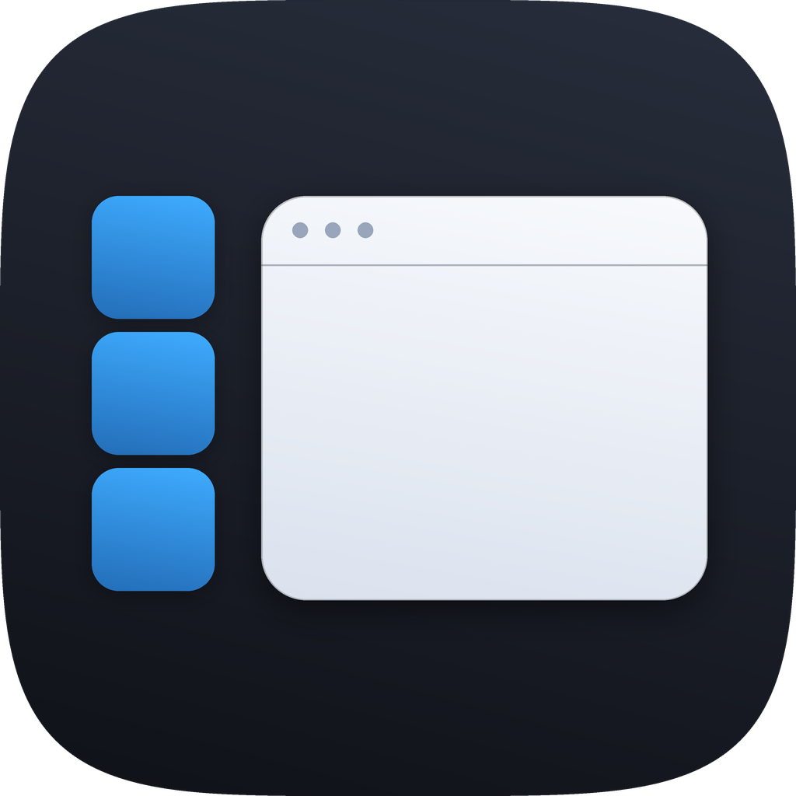

<p align="center">
  
</p>

<h1 align="center">Stage Manager for Windows</h1>

<p align="center">
  macOS Stage Manager, on Windows 10 / 11: the app you work in stays on the stage, every other app is grouped and parked in a strip along the left edge.
</p>

<p align="center">
  <a href="README.zh-CN.md">简体中文</a> · <strong>English</strong>
</p>

<p align="center">
  <a href="https://github.com/e1roy/stage_manager_for_windows/releases"></a>
  <a href="LICENSE"></a>
  
</p>

## Overview

Stage Manager for Windows is a window manager for Windows. The application you are working in stays on the stage in the middle of the desktop; every other application is grouped by app and parked in a strip along the left edge. Clicking a card flies the current app into that card's slot while the picked app grows out of it, so the rest of the strip keeps its order.

**Every display has its own stage and strip.** A window belongs to the display it sits on: drag it to another display and it joins that display's stage instead of being parked as a stray window.

Two strip modes are available:

- **Fixed:** reserves a strip of desktop work area through the Windows AppBar API, so maximized windows never cover it; it yields its topmost position while a full-screen app is running.
- **Floating:** shows the strip while there is room and slides away when a window on the stage covers it; move the pointer to the leftmost 2 pixels of a display to bring it back (the inner edge where two displays meet needs about 250 ms, so crossing displays does not trigger it by accident).

## Download

Download the latest installer from [GitHub Releases](https://github.com/e1roy/stage_manager_for_windows/releases/latest). The installer is built from the current source, installs for the current user only, needs no administrator privileges, and needs no separate runtime.

> [!WARNING]
> The installer is not code-signed. Windows SmartScreen may show an unknown publisher warning. Verify the SHA-256 value shown on the release page before running it.

## Features

- Only the current app stays on the stage; the others are parked in the strip of their display (this can be turned off, leaving the strip as a plain list)
- Click a card to switch apps; Alt+Tab, taskbar clicks and newly opened windows take the stage of that display right away
- Drag a card onto the desktop, or Shift-click it, to add its app to the current stage, side by side with the apps already there
- A stage can hold several apps: they leave it together as one card, and clicking the card — or activating any of them — brings the whole set back; right-click a set's card to split it
- Drag a window into the strip to take its app off the stage on its own
- Click the wallpaper to send that display's stage into the strip (can be turned off)
- Windows you minimize yourself go to the taskbar: they leave the stage without appearing in the strip, and take the stage again when you restore them
- Windows of the same app stack into one card (up to three layers); cards shrink as apps are added, and the strip scrolls with the mouse wheel when there are more
- Cards are drawn in perspective with soft shadows and large app icons, and turn toward you on hover
- Windows that leave the stage are parked just outside the desktop, keeping their size and state, and come back instantly
- Every parked window is returned to the desktop on exit, crash or sign-out (a journal covers crashes)
- Tray icon: left click opens the settings, right click shows or hides the strip, pauses, or quits
- Settings: display mode, width, icon size, perspective, hiding the windows off stage, clearing the stage by clicking the wallpaper, per-display strips, launch at login, pause, and bringing back windows that ended up off screen
- `Stage Manager for Windows.exe --quit` ends the running instance and brings every window back
- No telemetry and no network communication

## Requirements

- Windows 10 / Windows 11
- x64 processor
- Desktop Window Manager (DWM) enabled

Applications running as administrator may not be movable or activatable by a non-elevated Stage Manager for Windows process.

## Usage

1. Install and launch Stage Manager for Windows.
2. Right-click the tray icon and choose **Settings…** to pick Fixed or Floating mode, whether windows off stage are hidden, and the strip width and icon size.
3. Click a card to bring that app onto the stage; the current app is parked in the strip.
4. Drag a card onto the desktop (or Shift-click it) to show its app next to the current one; from then on they come and go as a set.
5. Click the wallpaper to clear the stage; open or activate any app to start a new one.
6. In Floating mode, move the pointer to the leftmost 2 pixels of a display when the strip is covered.

Additional controls:

| Action | Control |
| --- | --- |
| Open settings | Left-click the tray icon, or right-click → **Settings…** |
| Show / hide the strip | Right-click → **Show / hide strip** (Floating mode only) |
| Browse app cards | Mouse wheel over the strip |
| Add an app to the stage | Drag its card onto the desktop, or Shift-click it |
| Take an app off the stage | Drag its window into the strip |
| Split a set / close a window | Right-click its card → **Split set** / **Close window** |

Settings are stored at `%LOCALAPPDATA%\Stage Manager\settings.json`; the parking journal lives in the same directory.

## How it works

Stage Manager for Windows is written in Go. The interface is drawn by [MyGo](https://github.com/egoist/mygo) as native UI (Direct3D 11): pure Go, no cgo, no WebView2.

| Component | Responsibility |
| --- | --- |
| MyGo native UI | Strip, settings window, flight layer and still frames (perspective, shadows, rounded corners) |
| Win32 / DWM | Window enumeration and filtering, parking and restoring, AppBar, WinEvent hooks, `PrintWindow` still frames |
| Window parking | Moves windows just outside the desktop, keeping their size and their display's DPI, with a crash-recovery journal |
| Flight layer | One transparent, click-through window per display: still frames fly between the strip and the stage while the real windows are handed over beneath them |
| WinEvent hooks | React to activation, new windows, moves, minimizing and closing without polling |
| Watchdog | If the main thread stops answering for 5 seconds, returns every parked window using the journal and writes out the stack of each goroutine |

See [`stage_mgr_go/README.md`](stage_mgr_go/README.md) for the code layout.

## Build from source

Go 1.27.1 or newer is required:

```powershell
git clone git@github.com:e1roy/stage_manager_for_windows.git
cd stage_manager_for_windows\stage_mgr_go
go run .              # run for development
go test ./...         # unit tests and headless UI tests
go tool mygo vet .    # check UI lifecycle issues
go tool mygo build    # build/windows-amd64/Stage Manager for Windows.exe and the installer
```

Environment variables that keep a test run from rearranging your own windows:

| Variable | Effect |
| --- | --- |
| `STAGEMANAGER_APP_FILTER` | Only manage these executables (comma-separated, e.g. `notepad,mspaint`) |
| `STAGEMANAGER_DATA_DIR` | Directory for settings and the parking journal (default `%LOCALAPPDATA%\Stage Manager`) |
| `STAGEMANAGER_DEBUG` | Log decisions; a second instance then takes `--debug-hang` to block the main thread on purpose, to exercise the watchdog |
| `STAGEMANAGER_SNAPSHOT_DIR` | Makes `go test ./internal/app -run TestSnapshots` render the UI to PNGs |

## Known limitations

- The strip shows the still frame taken when a window left the stage: Windows does not paint windows outside the desktop, and a parked window is not changing anyway.
- Windows whose content `PrintWindow` cannot capture (some games, DRM-protected video) appear as frosted cards with their icon.
- Windows privilege isolation may keep Stage Manager for Windows from moving or activating applications running as administrator.
- Always-on-top windows stay out of the stage and float above it.

## Contributing

Issues and pull requests are welcome. When changing code:

1. Fork the repository and create a focused branch.
2. Read and write all state on the MyGo main thread; do slow work such as captures in a goroutine and come back to the main thread.
3. Run `go test ./...` and `go tool mygo vet .`, and try both Fixed and Floating modes by hand.
4. Describe the behaviour change and your manual verification in the pull request.

Please use [GitHub Issues](https://github.com/e1roy/stage_manager_for_windows/issues) for bug reports and feature proposals.

## Privacy

Stage Manager for Windows processes window handles, titles, icons and window frames locally. It has no analytics, telemetry, account system, or network service.

## License

Stage Manager for Windows is released under the [MIT License](LICENSE).
