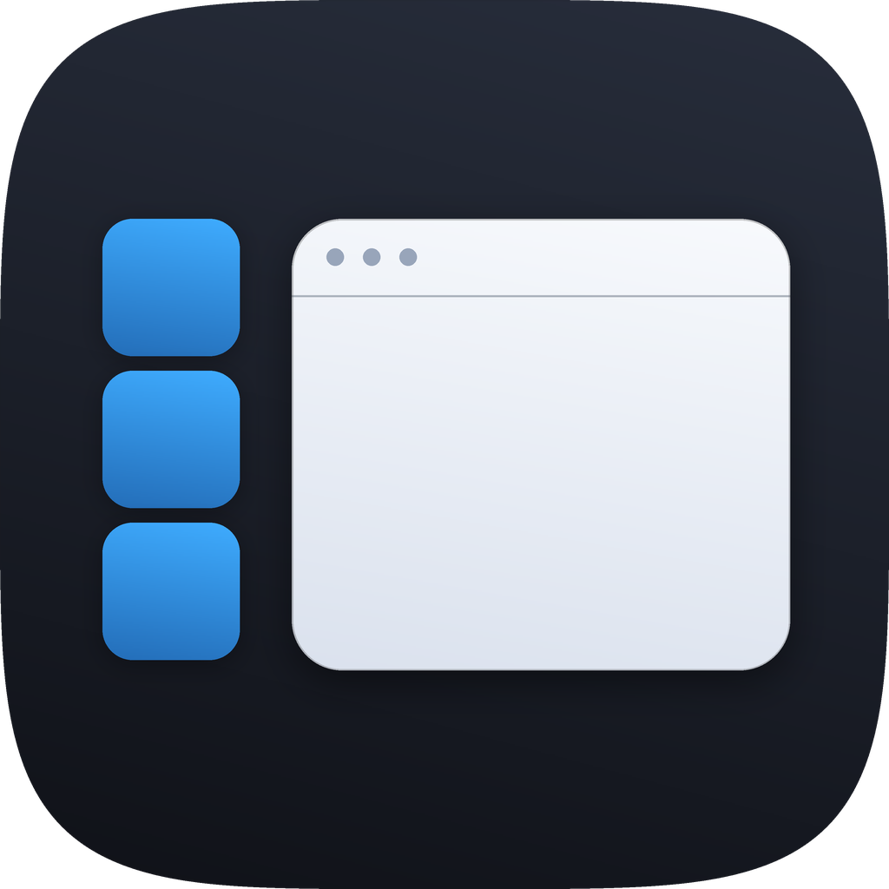
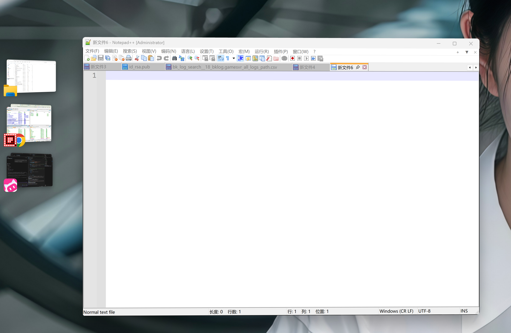

<p align="center">
  
</p>

<h1 align="center">Stage Manager for Windows</h1>

<p align="center">
  macOS Stage Manager, on Windows.
</p>

<p align="center">
  <a href="README.zh-CN.md">简体中文</a> · <strong>English</strong>
</p>

<p align="center">
  <a href="https://github.com/e1roy/stage-manager-for-windows/releases"></a>
  <a href="LICENSE"></a>
  
</p>

https://github.com/user-attachments/assets/d7c72abf-a951-44b9-9254-7b855a17b556

<p align="center">
  
</p>

## What it does

Only the app you're using stays on the desktop. Everything else shrinks into cards along the left edge. Click a card to switch to it.

## Features

- One stage and one strip per monitor: only the app you're using stays on the desktop.
- The rest are grouped by app into cards, on the left or the right edge.
- Click a card to switch; Alt+Tab and the taskbar work as usual.
- Drag a card to the desktop, or Shift-click it, for two apps side by side.
- The card of the stage you just left gets a dashed outline in the accent color, so after a detour to another app you can see at a glance what you were in the middle of. It can be turned off in Settings → Strip.
- List of the stage's windows: when the stage holds more than one window, small live thumbnails of them are listed top to bottom at the top of the strip, numbered 1/N, the active one highlighted, each tile tinted with the main color its window shows (black, white and gray left out), so windows of one app, such as VS Code windows with different title bar colors, tell apart at a glance. Click one to bring it to the front, hover to close it, or right-click to send its app to the strip. It can be turned off in Settings → Strip.
- Overview of every window on a display: click one to switch, or hover it to close it. Win+Tab opens it on every display at once, as Task View does, and so does a button over the display's bottom-left corner. With the strip on the left, that button and the panel at the bottom of the strip join into one big rounded button, flush with the screen's left and bottom edges, that lights up as one. The panel is frosted glass: its opacity and how much it blurs what is behind it are in the settings.
- Drag a window to another monitor and it joins the stage there.
- Drag a card up or down to reorder the strip, or into another monitor's strip to move the app there without opening it.
- Fixed or floating strip, per monitor, with adjustable width, icons, spacing and tilt.
- Right-click a card to switch to it, join the stage, split a group, close its windows, or make its app a companion.
- Companions: tools you open beside an app (say, a commit dialog) join the stage instead of taking it.
- Nothing gets lost: quitting, crashing or signing out puts every window back, and a taskbar thumbnail peek brings one home for a moment.
- Interface in Simplified Chinese, Traditional Chinese, English and Japanese.

## Install

Grab the installer from [Releases](https://github.com/e1roy/stage-manager-for-windows/releases/latest) and run it. No admin rights needed.

> [!NOTE]
> The installer isn't signed, so Windows may warn about an unknown publisher. Click "Run anyway".

Works on Windows 10 and 11 (64-bit).

## How to use

- **Switch apps**: click a card on the left, or use Alt+Tab and the taskbar as usual.
- **See every window**: Win+Tab, or the panel at the bottom of the strip. Click one to switch to it; hover it to close it.
- **See the stage's windows**: the numbered thumbnails at the top of the strip list every window on the stage. Click one to bring it forward, hover to close it, right-click to send its app to the strip.
- **Close an app from the strip**: hover a card and click the round × at its top right; a card of several apps closes all of their windows.
- **Two apps at once**: drag a card onto the desktop, or Shift-click it.
- **Settings**: left-click the tray icon. Choose whether the strip is Fixed (always takes its edge) or Floating (hides when covered, comes back when you push the mouse to that edge), put it on the left or the right of each display, turn a display's strip off, and adjust width, icon size, spacing, tilt, flight speed and quality, language and launch at login.
- **Split a group**: right-click its card.
- **Restart / Quit**: right-click the tray icon → Restart or Quit. Both put every window back first; Restart then starts Stage Manager again.
- **Updates**: Stage Manager checks GitHub for a new release every few hours. When one is out, a red dot appears on the tray icon and on Settings → About; click "Download" there, or the first item of the tray menu, to open the release page. Turn it off in Settings → About.

## Known issues

- Cards show a snapshot from the moment the window was tucked away; they don't update live.
- Some games and DRM-protected video can't be captured, so their card shows only the icon.
- Apps running as administrator may not be manageable.

## Build it yourself

Requires Go 1.27.3 or newer:

```powershell
git clone git@github.com:e1roy/stage-manager-for-windows.git
cd stage-manager-for-windows\stage_mgr_go
go run .
```

See [stage_mgr_go/README.md](stage_mgr_go/README.md) for building and running it safely, and [docs/CODEMAP.md](docs/CODEMAP.md) for where each behavior lives. [Issues](https://github.com/e1roy/stage-manager-for-windows/issues) and PRs welcome.

## Other

No data collection. The only network access is checking GitHub for new releases, which you can turn off. [MIT License](LICENSE).

## Acknowledgements

This project is forked from [renkai9418/stage-bar](https://github.com/renkai9418/stage-bar). Thanks to [@renkai9418](https://github.com/renkai9418) for the original work.
