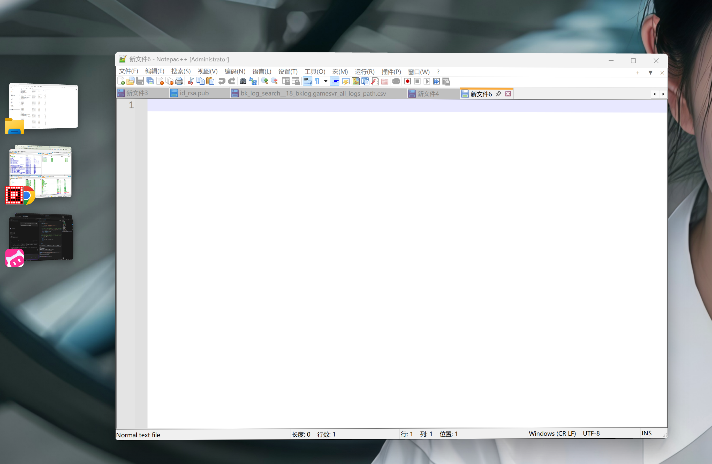

<p align="center">
  
</p>

<h1 align="center">Stage Manager for Windows</h1>

<p align="center">
  把 macOS 的“台前调度”搬到 Windows 上。
</p>

<p align="center">
  <strong>简体中文</strong> · <a href="README.md">English</a>
</p>

<p align="center">
  <a href="https://github.com/e1roy/stage-manager-for-windows/releases"></a>
  <a href="LICENSE"></a>
  
</p>

https://github.com/user-attachments/assets/d7c72abf-a951-44b9-9254-7b855a17b556

<p align="center">
  
</p>

## 它是干什么的

桌面上只留你正在用的那个应用，其他的都缩成小卡片排在屏幕左边。想切到哪个，点一下卡片就行。

## 功能

- **每台显示器都有自己的舞台和侧边栏**。正在用的应用留在屏幕中央，其余按应用分组收进屏幕左边缘的卡片（也可以在设置里改到右边，按显示器分别设置）。窗口不会跨显示器移动，所以 DPI 不会变。
- **切换**。点一下卡片，两边的应用互换位置；Alt+Tab、任务栏、刚打开的窗口都会立刻成为舞台。点桌面壁纸可以把当前应用也收起来（可关闭）。
- **两个应用并排**。把卡片拖到桌面，或者按住 Shift 点它，就把这个应用加进当前舞台。右键卡片可以切换过去、加入舞台、拆开组合，或者关掉它的窗口。
- **“所有窗口”概览**，像 macOS 的 Mission Control：当前显示器的所有窗口（连同它们所在的舞台）一起铺开在变暗的桌面上。点一个就切换过去；鼠标移上去，点右上角的关闭按钮可以直接关掉它。点空白处或按 Esc 全部收回去。三个入口：侧边栏底部的面板、显示器左下角的按钮（Win11 任务栏居中、角落空着时出现），以及 Win+Tab，再按一次收起。
- **拖动窗口**。把窗口拖到另一台显示器，那边的舞台会让位；拖进侧边栏则把这个应用请下舞台。用 Win+Shift+方向键移动窗口，效果和拖过去一样。
- **不会丢窗口**。不在舞台上的应用是“停放”到桌面之外，而不是最小化：大小和状态都保留，回来立刻恢复。每次停放都写日志，所以退出、崩溃、被强杀、注销都会把所有窗口放回原处。从任务栏缩略图预览（peek）时，被停放的窗口会临时回来给你看。
- **固定 / 浮动侧边栏**。固定模式像任务栏一样占着屏幕边缘，遇到全屏应用自动让出；浮动模式有空间就显示，被舞台窗口挡住就滑走，鼠标移到屏幕边缘再出来。
- **设置**（左键点托盘图标）：侧边栏模式、宽度、图标大小、卡片间距、卡片的 3D 倾斜、画面质量、是否收起不在舞台的应用、点击壁纸是否清空舞台、每台显示器的侧边栏放左边还是右边以及要不要关掉、随从应用（不抢舞台而是并排加入，比如文件管理器旁边弹出的 SVN 提交窗口）、概览面板和角落按钮的大小、Win+Tab、开机启动，以及概览按钮在鼠标悬停时的高亮颜色。界面支持简体中文、繁体中文、英文、日文，默认跟随 Windows 显示语言。
- **同一应用的窗口叠成一张卡片**（最多显示 3 层）；应用多了卡片自动缩小，再多可以滚动。
- **托盘图标**：左键打开设置；右键菜单可以找回屏幕外的窗口、打开设置、退出。`StageManagerForWindows.exe --quit` 让正在运行的实例退出并放回所有窗口，安装包就是这么做的。
- 不联网，不收集任何数据。

## 安装

到 [Releases](https://github.com/e1roy/stage-manager-for-windows/releases/latest) 下载安装包，双击装上就能用，不需要管理员权限。

> [!NOTE]
> 安装包没有签名，Windows 可能提示“未知发布者”，点“仍要运行”即可。

支持 Windows 10 和 11（64 位）。

## 怎么用

- **切换应用**：点左边的卡片，或者照常用 Alt+Tab、任务栏。
- **看全部窗口**：从侧边栏底部的面板、显示器左下角的按钮，或者 Win+Tab 打开概览。点一个窗口切换过去；鼠标移上去，点右上角的按钮可以直接关掉它。
- **两个应用并排**：把卡片拖到桌面，或者按住 Shift 点它。
- **设置**：左键点托盘图标。可以选侧边栏是“固定”（一直占着左边）还是“浮动”（被挡住就藏起来，鼠标移到屏幕最左边再出来），也能调宽度、图标大小、动画速度、开机启动。
- **拆开一组**：右键卡片。
- **退出**：右键托盘图标 → 退出。

## 已知问题

- 卡片里显示的是窗口收起那一刻的截图，不会实时更新。
- 部分游戏、受版权保护的视频截不到图，卡片上只显示图标。
- 以管理员身份运行的程序可能管不了。

## 自己编译

需要 Go 1.27.1 以上：

```powershell
git clone git@github.com:e1roy/stage-manager-for-windows.git
cd stage-manager-for-windows\stage_mgr_go
go run .
```

代码结构、调试方法见 [stage_mgr_go/README.md](stage_mgr_go/README.md)。欢迎提 [Issue](https://github.com/e1roy/stage-manager-for-windows/issues) 和 PR。

## 其他

不联网，不收集任何数据。[MIT 许可证](LICENSE)。

## 致谢

本项目 fork 自 [renkai9418/stage-bar](https://github.com/renkai9418/stage-bar)，感谢 [@renkai9418](https://github.com/renkai9418) 的原始工作。
